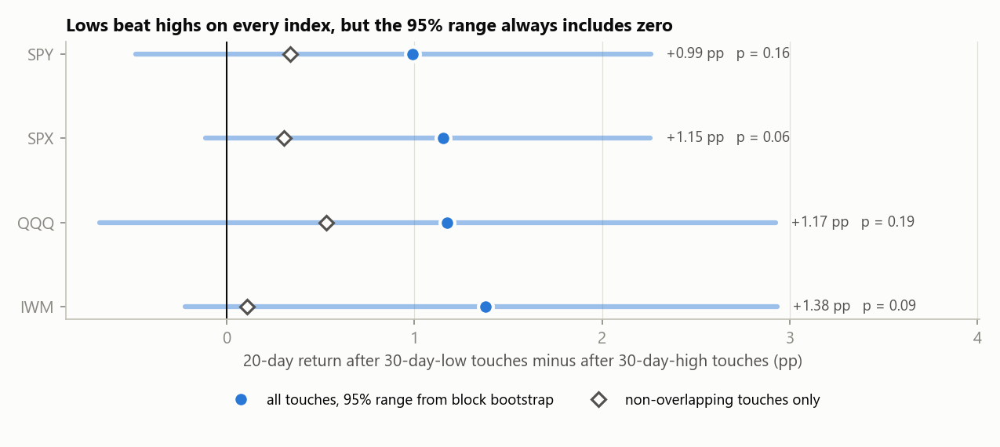
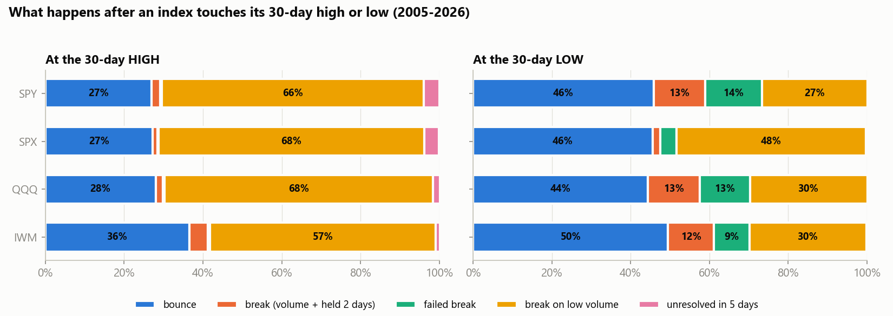

# Index 30-Day High / Low Study: SPY, SPX, QQQ, IWM

[](https://github.com/GpuCpuPsu/index-levels/actions/workflows/tests.yml)

When a major US index touches its 30-day high or low, does it bounce or break through? And is it really better to buy near the lows than near the highs? This tests both on **SPY, the S&P 500 index (SPX), QQQ and IWM** over 2005–2026, with significance tests that account for overlapping samples.

**Main finding:** on every index, the 20 days after a 30-day-low touch beat the 20 days after a 30-day-high touch, by **+1.0 to +1.4 percentage points**. But **the gap is not statistically significant on any of them**. Once overlapping touches are handled properly, it shrinks to +0.1 to +0.5 points. The pattern is consistent, but too small to separate from noise.



*Dot: measured gap using all touches. Bar: 95% range from a block bootstrap. Diamond: the gap using only touches at least 20 trading days apart. Every bar crosses zero.*

## What happens at the level



- **At 30-day highs, indexes rarely reverse.** About two-thirds of touches close above the high within 5 days, but almost always on ordinary volume. High-volume breakouts that hold are only 1–5% of touches.
- **At 30-day lows, about half bounce** (44–50%). High-volume breakdowns are more common (12–13% on the ETFs), but roughly half of them **fail**, closing back above the low within 2 days.
- **IWM** (small caps) bounces off its highs more often than the large-cap indexes (36% vs 27–28%).

## Rules

- **Touch:** the day's high comes within 0.5% of the highest high of the previous 30 days, or the day's low within 0.5% of the lowest low. The level is built only from earlier days.
- **Outcome**, whichever happens first within 5 trading days:

| Outcome | Rule |
|---|---|
| **break** | closes beyond the level, on volume ≥ 1.5× its 20-day average, **and** the next 2 closes stay beyond it |
| **failed break** | that high-volume close happened, but price closed back inside within 2 days |
| **break on low volume** | closes beyond the level without that volume |
| **bounce** | closes back inside by at least 1% before any close beyond |
| **unresolved** | none of the above within 5 days |

One test of a level counts once: the next touch on the same side is only counted after the previous one resolves.

## Results (2005-01-03 to 2026-10-23)

| Index | Touches (high / low) | Bounce at high / low | Confirmed break at high / low | 20-day gap, low − high | p (60-day blocks) | Non-overlapping gap (p) |
|---|---|---|---|---|---|---|
| SPY | 1059 / 355 | 27% / 46% | 2.2% / 13.0% | +0.99 pp | 0.16 | +0.34 pp (0.63) |
| SPX | 1040 / 377 | 27% / 46% | 1.2% / 1.9% | +1.15 pp | 0.06 | +0.31 pp (0.66) |
| QQQ | 1067 / 363 | 28% / 44% | 1.9% / 13.2% | +1.17 pp | 0.19 | +0.53 pp (0.45) |
| IWM | 833 / 432 | 36% / 50% | 4.7% / 11.6% | +1.38 pp | 0.09 | +0.11 pp (0.90) |

**How the significance test works:** touches overlap heavily. A 20-day window after one touch shares most of its days with the next touch's window, and touches cluster in the same few rallies and selloffs. So they are not independent samples. Two methods respect that:
- A **circular block bootstrap** resamples whole stretches of calendar time (20, 60, 120 and 250-day blocks), keeping clustered days together. All block lengths are in `results/summary.json`.
- A **non-overlapping test** keeps only touches at least 20 trading days apart on the same side, then runs a Welch t-test.

## Read before using this

- **The four indexes are not four independent confirmations.** They move together, so a pattern on all four is largely the same pattern seen four times.
- **SPX volume is not comparable.** Yahoo's `^GSPC` volume is aggregate exchange volume, not trading in one security. That's why SPX shows almost no high-volume breaks. Use SPY for any volume-based rule.
- **Outcome labels use the days after the touch**, so "what happened after a bounce" is not tradable: you can't know it bounced at the touch. The tradable numbers are the outcome rates and the forward returns over *all* touches.
- Prices are split/dividend adjusted (Yahoo Finance). No trading costs are modelled. This is research, not investment advice.

## Running it

```bash
python -m venv .venv
.venv/Scripts/python -m pip install -r requirements.txt   # Windows; .venv/bin/python on macOS/Linux
python src/run_study.py      # downloads prices, writes results/ (about a minute)
python src/make_charts.py    # rebuilds docs/img/
pytest                       # 14 offline tests
```

| Path | What it is |
|---|---|
| `src/levels.py` | Touch detection and outcome rules |
| `src/significance.py` | Block bootstrap, thinning, Welch test, and `gap_test()` |
| `src/run_study.py` | Runs every index and writes `results/` |
| `src/make_charts.py` | Builds the README charts |
| `src/data.py` | Yahoo Finance loader with a disk cache |
| `tests/` | Level rules (bounce / break / failed break, levels use only earlier days, end-of-data handling) and the significance methods |
| `results/` | Every touch per index (`<INDEX>_events.csv`) and `summary.json` |

Split out of [multifactor-backtest](https://github.com/GpuCpuPsu/multifactor-backtest), where this started as a SPY-only side study.
